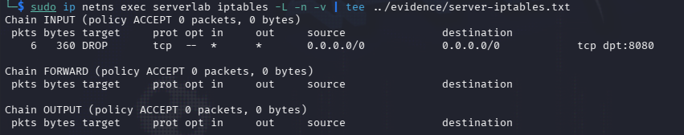

# Network Troubleshoting Investigation

## Project Overview

This project simulates a real network troubleshooting scenario in a controlled Linux lab environment.

A client was unable to access an internal web application hosted on TCP port `8080`. The goal was to identify the root cause.

## Lab Environment

The lab was created using Linux network namespaces.

- Client: `10.20.30.10`
- Server: `10.20.30.20`
- Web service: TCP port `8080`

The client and server were connected using a virtual Ethernet pair.

## Tools Used

- `ip`
- `ping`
- Nmap
- `ss`
- Wireshark
- tcpdump
- iptables
- curl

## Investigation

### 1. Network Connectivity

The client network configuration was checked using `ip addr` and `ip route`.

The server responded successfully to ICMP echo requests, confirming that basic IP connectivity between the client and server was working.

### 2. Port Scan

I scanned TCP port `8080` using:

`sudo nmap -sS -p 8080 10.20.30.20`

Nmap reported the port as `filtered`, which suggested that traffic might be dropped or filtered.

### 3. Packet Analysis

Wireshark showed SYN packets being sent from the client to the server, but no SYN/ACK or RST/ACK response was received.

### 4. Server-Side Service Check

I used `ss -tulnp` on the server to verify whether the web service was running.

The Python web server was listening on `0.0.0.0:8080`, confirming that the service was active and listening on all IPv4 interfaces.

### 5. Firewall Investigation

The server firewall rules were checked using `iptables`.

A `DROP` rule was found for TCP port `8080`. After generating connection attempts from the client, the packet counter on the rule increased, confirming that the firewall was dropping the traffic.

## Root Cause

The web application was running correctly, but an iptables firewall rule was dropping all incoming TCP traffic to port `8080`.

## Fix and Verification

The firewall rule blocking TCP port `8080` was removed.

After the change:

- Nmap reported port `8080` as open
- `curl http://10.20.30.20:8080` successfully returned the web page

This confirmed that the issue was resolved.

## Evidence

Detailed command outputs are available in the `evidence` directory.

A more detailed investigation report is available in:

`report/findings.md`
