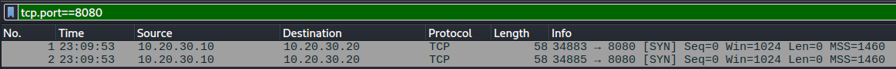

# Findings

## Scenario

A user reports that an internal web application is not accessible.

The client and server are on the same internal network.

The goal is to identify the root cause, fix the problem and verify that the service is working correctly.

## Lab Setup

The lab uses two Linux network namespaces connected with a virtual Ethernet pair.

- Client: '10.20.30.10'
- Server: '10.20.30.20'
- Web service: TCP port '8080'

## Initial network check

### Client Configuration

The cilent had the IP address '10.20.30.10/24' on the 'veth-client' interface.

The routing table showed that the '10.20.30.0/24' network was directly connected, so no gateway was required to reach the server.

### Ping Test

The next step was to ping the server using 'ping -c 4 10.20.30.20' to check basic network connectivity.

The server responded to the ICMP requests, which confirmed that the client could reach the server at the IP layer.

### Port Scan

After confirming that the server was reachable, the next step was to scan TCP port 8080 using 'sudo nmap -sS -p 8080 10.20.30.20'.

Nmap reported the port as 'filtered'. This means that the scan did not receive a response that could confirm whether the port was open or closed.

### Packet Analysis

Because TCP port `8080` was reported as filtered, the next step was to capture the traffic in Wireshark.

Wireshark showed two `SYN` packets sent from the client to the server, but there was no response from the server. This confirmed that the connection were not receiving `SYN/ACK` or `RST/ACK` responses.

### Server-Side Service Check

To verify whether the web service was running on the server, I used `ss -tulnp` inside the `serverlab` namespace.

The output showed that a Python web server was listening on `0.0.0.0:8080`. This confirmed that the service was running and was listening on all IPv4 interfaces, so the issue was not caused by the service being stopped or listening only to localhost.

### Firewall Investigation

After confirming that the web service was running on port `8080`, I checked the server firewall rules using `iptables`.

The firewall contained a `DROP` rule for TCP port `8080`. After generating traffic from the client, the packet counter on this rule increased to 6 packets, confirming that the firewall was dropping the connection attempts.

This identified the firewall rule as the root cause of the connectivity problem.

### Fix and Verification

The firewall rule that was dropping TCP traffic to port `8080` was removed.

After the change, I repeated the port scan from the client. Nmap reported TCP port `8080` as open.

I then used `curl http://10.20.30.20:8080` to verify the web service. The server returned the web page successfully, confirming that the connectivity problem was resolved.

## Final Conclusion

The client was able to reach the server at the IP layer, but TCP connections to port `8080` were being dropped.

The web service was running correctly and listening on all IPv4 interfaces. Packet analysis showed SYN packets leaving the client without receiving a response, while the server firewall contained a DROP rule for TCP port `8080`.

The firewall rule was identified as the root cause. After removing the rule, port `8080` became reachable and the web application was successfully accessed from the client.
